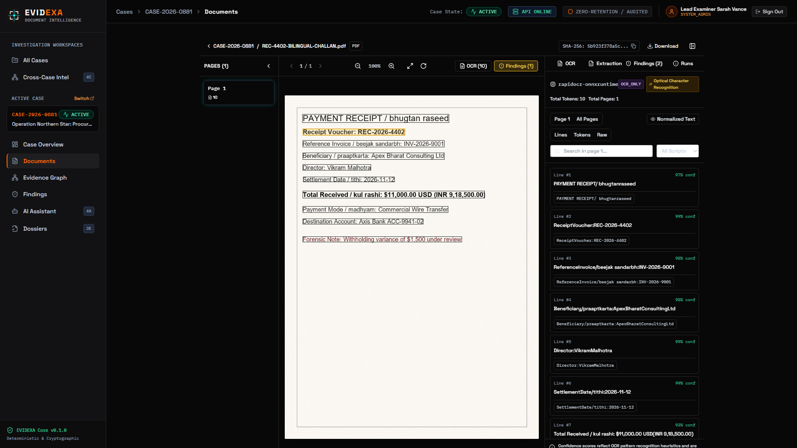
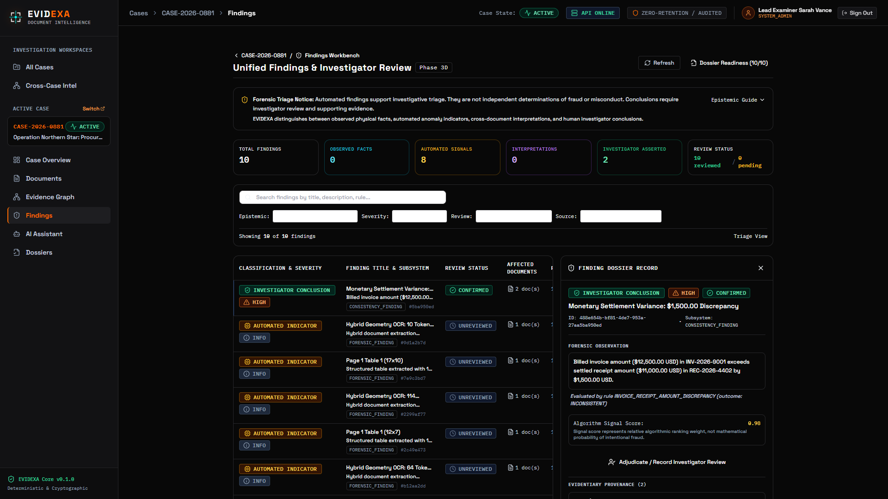
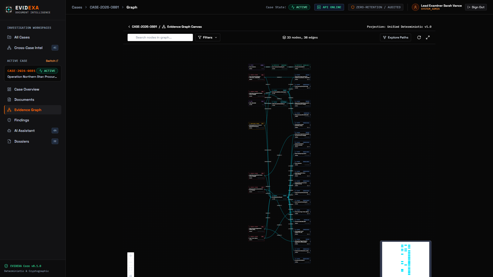
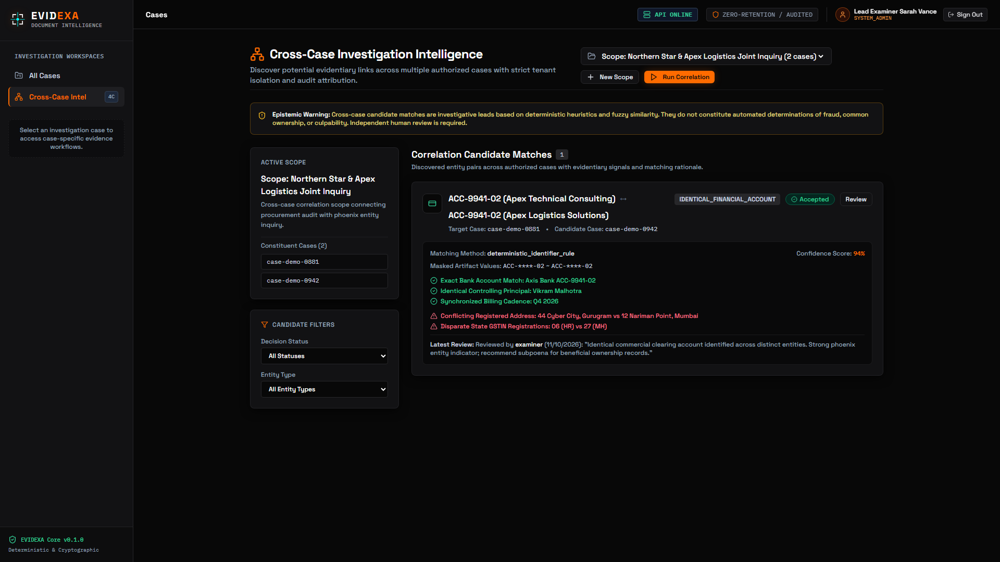
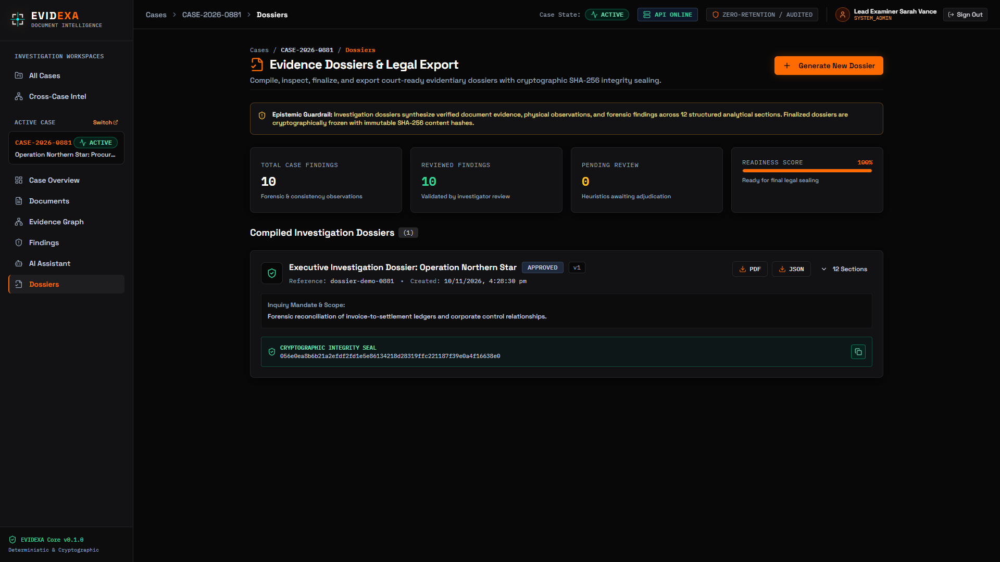
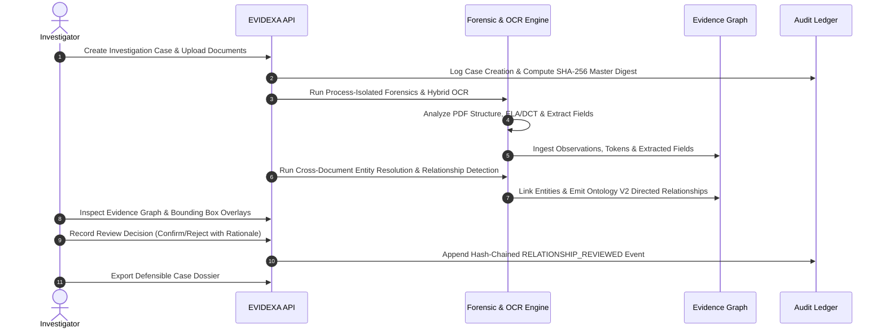
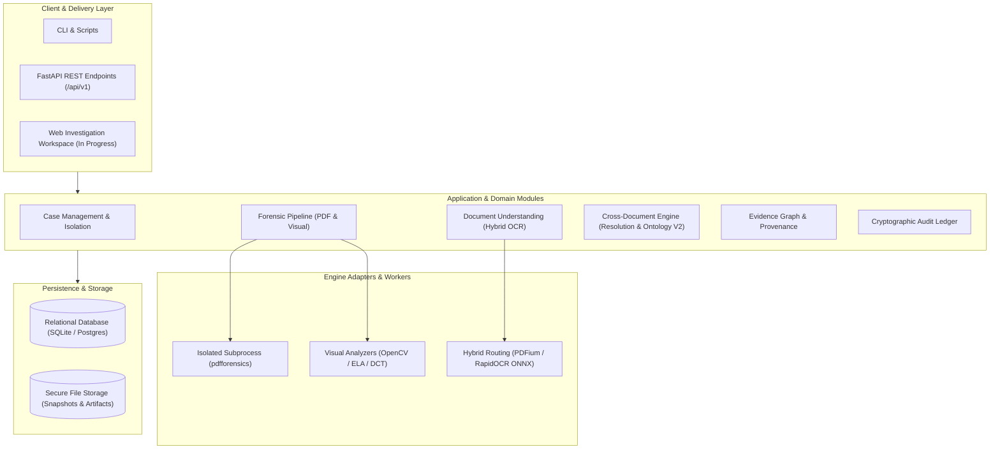

<div align="center">

<p align="center">
  
</p>

### **AI-Powered Digital Forensics & Document Intelligence**

*Intelligence Behind Every Evidence.*  
**Uncover the Truth. Verify Every Detail.**

[](https://github.com/shubhamranswal/evidexa)
[](https://www.python.org/)
[](LICENSE)
[](docs/ARCHITECTURE.md)
[](docs/DEVELOPMENT_STATUS.md)
[](docs/DEVELOPMENT_STATUS.md)

<p align="center">
  <b>EVIDEXA</b> is an enterprise-grade digital forensics and contextual intelligence platform designed to uncover document tampering, extract structured information with mathematical precision, correlate entities across complex records, and construct tamper-evident, court-defensible investigation dossiers.
</p>

[Product Overview](docs/PRODUCT_OVERVIEW.md) • [Feature Matrix](docs/FEATURES.md) • [Architecture](docs/ARCHITECTURE.md) • [Security Policy](docs/SECURITY.md) • [Roadmap](docs/ROADMAP.md) • [API Reference](docs/API.md)

---

</div>

> [!NOTE]
> **Development Status:** EVIDEXA is currently under active pre-release engineering (`v0.1.0-alpha`). Core structural PDF forensics, visual tampering detection, hybrid bilingual (Hindi/English) OCR routing, entity resolution, relationship ontologies, the interactive visual investigation workspace, and tamper-evident dossier export are implemented and verified with **596 backend tests** and **105 frontend tests** passing. See [Development Status](docs/DEVELOPMENT_STATUS.md) and [Feature Matrix](docs/FEATURES.md) for granular readiness details.

---

## The Problem EVIDEXA Solves

Financial underwriting, corporate fraud examination, insurance claims auditing, and regulatory compliance investigations are overwhelmed by growing volumes of digital and scanned documentation. Sophisticated digital tampering-such as spliced bank balances, cloned signature blocks, injected font streams, hidden incremental revisions, and synthetic applicant networks-routinely slips past traditional inspection systems.

Organizations face a critical trilemma:

1. **Blind Document Processing:** Standard Intelligent Document Processing (IDP) and OCR engines read text but are completely blind to pixel-level forgery, compression anomalies, and underlying file-structure alterations.
2. **Disconnected Forensic Tools:** Standalone image forensics software outputs isolated heatmaps that cannot extract tabular business data, link cross-document relationships, or explain findings in business context.
3. **Unaccountable AI Judgments:** Black-box machine learning models generate arbitrary risk scores without sub-document evidence, creating severe legal, compliance, and regulatory liability.

**EVIDEXA bridges this divide.** By coupling deterministic low-level file forensics with modern optical document understanding and a directed knowledge graph, EVIDEXA provides investigators with an explainable, evidence-backed platform where every insight is traceable to its source.

---

## Core Product Capabilities

EVIDEXA is built around five integrated capability pillars:

```
┌────────────────────────────────────────────────────────────────────────┐
│                        EVIDEXA CAPABILITY MATRIX                       │
└────────────────────────────────────────────────────────────────────────┘
     │                    │                    │                    │
┌────▼──────────────┐┌────▼──────────────┐┌────▼──────────────┐┌────▼──────────────┐
│ Document Ingestion││ Digital Document  ││ Cross-Document    ││ Evidence Graph    │
│  & Understanding  ││    Forensics      ││   Intelligence    ││  & Provenance     │
├───────────────────┤├───────────────────┤├───────────────────┤├───────────────────┤
│ • Hybrid OCR      ││ • PDF Structure   ││ • Entity Resolution││ • Unified DAG     │
│ • Coordinate Norm ││ • Incremental Upd ││ • Ontology V2 SPO ││ • Sub-Doc Bounding│
│ • Schema Extract  ││ • ELA & DCT Tamper││ • Invoice vs Supply││ • Token Linage   │
│ • Decimal Exactness││• Font Inconsistency││• Contradiction Pre││• Chained Ledger │
└───────────────────┘└───────────────────┘└───────────────────┘└───────────────────┘
                                   │
                         ┌─────────▼─────────┐
                         │   Investigation   │
                         │    & Reporting    │
                         ├───────────────────┤
                         │ • Case Workspace  │
                         │ • Human-in-Loop   │
                         │ • Audit History   │
                         │ • Court Dossier   │
                         └───────────────────┘
```

### 1. Document Ingestion & Understanding
- **Multi-Format Ingestion:** Ingests digital PDFs, scanned documents, TIFFs, and raster image files (PNG, JPEG) with strict magic-byte verification.
- **Adaptive Hybrid OCR Routing:** Intelligently evaluates character density and raster page area to route vector pages to native extractors (PDFium) and scanned pages to deep neural OCR (RapidOCR/ONNX).
- **Canonical Coordinate Invariants:** Maps spatial data across all engines into `NORMALIZED_0_1` (top-left $[0.0, 0.0]$, bottom-right $[1.0, 1.0]$), preserving positional geometry across rotations and resolutions.
- **Exact Financial Precision:** Quantizes currency amounts using formal minor unit rules (USD 2, JPY 0, KWD 3) via Python `Decimal`, eliminating floating-point rounding errors.
- **Privacy-First PII Protection:** Automatically masks sensitive account numbers (`****{last4}`), tax IDs, and personal identifiers at extraction.

### 2. Digital Document Forensics
- **Structural PDF Analysis:** Scans internal PDF object streams, cross-reference (XREF) tables, and linearization dictionaries to expose appended incremental updates and hidden object revisions.
- **Font & Content Stream Forensics:** Detects anomalous font encodings, synthetic glyph maps, and unauthorized content stream injections.
- **Visual Tampering Detection:** Identifies digital splicing, erased text, and altered financial numbers using Error Level Analysis (ELA) and Discrete Cosine Transform (2D-DCT) copy-move block clustering.
- **Process Isolation & Ephemeral Snapshots:** Executes forensic analyzers in supervisor-bounded child subprocesses with ephemeral, read-only file snapshots verified via double SHA-256 integrity checks.

### 3. Contextual & Cross-Document Intelligence
- **Deterministic Entity Resolution:** Resolves organizations, persons, tax identifiers, bank accounts, and invoice references across disparate files without probabilistic ambiguity.
- **Directed Relationship Ontology (V2):** Encodes interactions using formal Subject-Predicate-Object semantics (`ISSUED`, `BILLED_TO`, `INVOICED`, `HELD_BY`, `SUPPLIES`, `REPRESENTS`, `DUPLICATE_OF`).
- **Commercial Invariant Separation:** Distinguishes discrete invoice billing events (`INVOICED`) from long-term ongoing contractual supply relationships (`SUPPLIES`), reserving `SUPPLIES` strictly for verified contract clauses.
- **Epistemic Status Separation:** Decouples formal status (`CONFIRMED`, `CANDIDATE`, `CONTRADICTED`, `UNRESOLVED`) from heuristic ranking scores. Heuristic scores represent sorting weights only and cannot independently confirm relationships.

### 4. Evidence Intelligence & Provenance Graph
- **Unified Evidence Graph:** Links cases, documents, pages, OCR tokens, visual heatmaps, extracted fields, and resolved entities into a directed acyclic graph.
- **Sub-Document Traceability:** Every extracted value and forensic finding links directly to its source document ID, page index, normalized bounding box, and OCR token ID.
- **Permanent Contradiction Visibility:** If an investigator overrides an algorithmic contradiction flag, conflicting evidence signals are permanently retained alongside reviewer justification for supervisory review.
- **Cryptographic Audit Ledger:** Maintains an append-only, SHA-256 hash-chained event ledger tracking every upload, analysis run, and review decision.

### 5. Investigation Workspace & Reporting
- **Single-Case Security Isolation:** Enforces strict boundary controls where all queries and operations are scoped to a case; unauthorized cross-case access attempts trigger 404 security barriers.
- **Human-in-the-Loop Review:** Provides structured review interfaces for matching entities and confirming candidate relationships with mandatory written audit justifications.
- **Court-Defensible Dossiers:** Compiles structured investigation dossiers featuring verified findings, visual forensic exhibits, supporting evidence, and complete chain-of-custody logs.

---

## Platform Visual Walkthrough

EVIDEXA delivers a cohesive, dark-themed digital forensic workstation built for fraud examiners, corporate compliance auditors, and digital investigators:

### 1. Multilingual Document Intelligence & Token Extraction
Dual-pane workspace pairing rendered PDF/scanned originals with deep neural OCR token streams, spatial bounding boxes, and structured invoice field parsing (supporting English and Devanagari/Hindi scripts).
<p align="center">
  
</p>

### 2. Discrepancy Reconciliation & Forensic Findings Workbench
Reconciles multi-document financial records (invoices, challans, and bank wires) to flag settlement variances, accompanied by deterministic rule provenance and signed investigator review logs.
<p align="center">
  
</p>

### 3. Interactive Evidence Graph & Multi-Entity Topology
Force-directed knowledge graph projecting typed semantic predicates (`CONTAINS_DOCUMENT`, `TRANSFERS_TO`, `REPRESENTS`, `HAS_EVIDENCE`) across corporate entities, directors, accounts, and discrepancies.
<p align="center">
  
</p>

### 4. Cross-Case Correlation & Ring Intelligence
Multi-case correlation within tenant-isolated scopes identifying recurring clearing accounts, common controlling principals, and phoenix company patterns across discrete legal proceedings.
<p align="center">
  
</p>

### 5. Cryptographic Evidence Dossier Workbench
Automated multi-section dossier compilation with section-level tamper verification, immutable audit event chaining, and SHA-256 cryptographic sealing for court and compliance reporting.
<p align="center">
  
</p>

---

## Investigation Workflow

EVIDEXA guides analysts through a structured, reproducible investigative pipeline:



---

## High-Level Architecture

EVIDEXA is architected as a **Modular Monolith** adhering to Clean Architecture and Domain-Driven Design (DDD) principles:



---

## Product Philosophy

EVIDEXA is built on seven inviolable operational principles:

1. **Evidence Before Conclusions:** The platform establishes verified, observable facts before proposing interpretations.
2. **Traceability for Every Finding:** An extracted value without traceable evidence is not a trustworthy value. Every finding links to verifiable bounding boxes, byte ranges, or token IDs.
3. **Explainable Analysis Over Opaque Judgments:** Black-box verdict scores without evidentiary breakdown are strictly rejected.
4. **Human Investigators Retain Authority:** EVIDEXA assists, accelerates, and organizes evidence for human experts; it is never deployed as an autonomous fraud judge.
5. **An Anomaly is Not Automatically Fraud:** Formatting quirks, benign scanning artifacts, and OCR ambiguities are presented objectively as anomalies requiring review, not convicted as fraud.
6. **Chain of Custody Protection:** Ingestion snapshots, double SHA-256 verification, and immutable audit logs guarantee forensic chain of custody.
7. **Deterministic Processing is Authoritative:** Mathematical algorithms, structural parsers, and explicit rule engines establish ground truth; AI models assist in contextual interpretation and synthesis.

---

## Intended Use Cases

| Industry / Domain | Key Investigation Challenge | How EVIDEXA Solves It |
|---|---|---|
| **Corporate Lending & Underwriting** | Spliced bank balances, fabricated financial statements, and synthetic corporate networks. | Unmasks pixel-level alterations, flags font substitutions, and cross-references multi-party invoices. |
| **Insurance Claims Fraud** | Cloned repair invoices, altered medical bills, and duplicate receipts across claims. | Detects duplicate documents (`DUPLICATE_OF`), identifies copy-moved elements, and verifies invoice citations. |
| **Forensic Accounting & Audit** | Discrepancies across general ledgers, invoices, purchase orders, and bank statements. | Correlates settlement relationships, enforces exact decimal quantization, and maintains complete audit trails. |
| **Regulatory Compliance & KYC** | Synthetic identity fraud, forged tax documents, and contradictory officer representations. | Resolves cross-document entity networks and detects contradictory tax IDs with zero plaintext PII leaks. |

---

## Technology Stack

- **Runtime & Language:** Python 3.12 (64-bit), CPU-optimized execution; Node.js 18+ (frontend).
- **Frontend Stack:** [React 18](https://react.dev/), [TypeScript](https://www.typescriptlang.org/), [Vite](https://vitejs.dev/), [Tailwind CSS](https://tailwindcss.com/), [TanStack Query v5](https://tanstack.com/query/latest), [Lucide Icons](https://lucide.dev/).
- **Web & API Framework:** [FastAPI](https://fastapi.tiangolo.com/), [Uvicorn](https://www.uvicorn.org/), [Pydantic v2](https://docs.pydantic.dev/).
- **Persistence & Migrations:** [SQLAlchemy 2.0](https://www.sqlalchemy.org/), [Alembic](https://alembic.sqlalchemy.org/) (Head: `008_evidence_dossier`).
- **PDF & Structural Forensics:** [pikepdf](https://pikepdf.readthedocs.io/), [pypdf](https://pypdf.readthedocs.io/), [pypdfium2](https://pypdfium2.readthedocs.io/).
- **OCR & Computer Vision:** [RapidOCR (ONNX Runtime)](https://github.com/RapidAI/RapidOCR), [OpenCV Headless](https://opencv.org/), [Pillow](https://python-pillow.org/), [NumPy](https://numpy.org/).
- **Testing & Quality Tooling:** [pytest](https://docs.pytest.org/), [Vitest](https://vitest.dev/), [Testing Library](https://testing-library.com/), [Ruff](https://astral.sh/ruff), [MyPy](https://mypy-lang.org/) (strict mode).

---

## Getting Started

### Prerequisites
- **Python:** Version 3.12 (64-bit)
- **OS:** Windows 11, macOS, or Linux
- **Memory:** 8 GB RAM minimum (16 GB recommended for multi-page OCR)
- **Hardware:** Standard CPU (zero GPU dependency required)

### Installation

Using `uv` (recommended for ultra-fast setup) or standard Python `venv`:

```powershell
# 1. Clone repository
git clone https://github.com/shubhamranswal/evidexa.git
cd evidexa

# 2. Create and activate virtual environment
python -m venv .venv
.venv\Scripts\activate      # Windows PowerShell
# source .venv/bin/activate  # Linux / macOS

# 3. Install in editable mode with development dependencies
python -m pip install --upgrade pip
python -m pip install -e ".[dev]"
# Or via uv: uv pip install -e ".[dev]"

# 4. Optional: Configure local environment settings
# copy .env.example .env    # Windows
# cp .env.example .env      # Linux / macOS

# 5. Initialize database schema via Alembic migrations (Head: 010_cross_case_correlation)
alembic upgrade head

# 6. Bootstrap local development administrator account (Argon2id hashed)
python scripts/bootstrap_dev_user.py --email examiner@evidexa.local --username examiner --password "Investigator2026!" --full-name "Lead Examiner Sarah Vance"

# 7. (Optional) Populate complete demonstration investigation dataset
# Seeds Operation Northern Star (bilingual OCR docs, graph entities, 10 reviewed findings, and sealed dossier)
python scripts/seed_demo_investigation.py
```

### Default Demonstration Credentials

| Role | Username | Email | Default Password |
|---|---|---|---|
| **Lead Forensic Examiner** | `examiner` | `examiner@evidexa.local` | `Investigator2026!` |

> [!NOTE]
> **Pretrained Model Assets:** Optical character recognition utilizes lightweight RapidOCR ONNX models (`ch_PP-OCRv4_det_infer.onnx`, `ch_PP-OCRv4_rec_infer.onnx`, `ch_ppocr_mobile_v2.0_cls_infer.onnx`) and the PP-OCRv5 Devanagari recognition model for bilingual Hindi/English documentation. These Apache-2.0 models run 100% on CPU without requiring external cloud tokens or GPU hardware.

### Running the Application

```powershell
# 1. Start EVIDEXA API backend server (port 8000)
python -m uvicorn document_intelligence.main:app --host 127.0.0.1 --port 8000 --reload

# 2. In a separate terminal, start the Investigator Frontend (port 5173)
cd frontend
npm install
npm run dev
```

Once running:
- **Public Showcase & Digital Light Table:** [http://localhost:5173/](http://localhost:5173/)
- **Investigator Workspace Login:** [http://localhost:5173/login](http://localhost:5173/login)
- **Local Account Registration:** [http://localhost:5173/register](http://localhost:5173/register)
- **Interactive OpenAPI (Swagger UI):** [http://127.0.0.1:8000/docs](http://127.0.0.1:8000/docs)
- **ReDoc Documentation:** [http://127.0.0.1:8000/redoc](http://127.0.0.1:8000/redoc)
- **Health Check Endpoint:** [http://127.0.0.1:8000/health](http://127.0.0.1:8000/health)

### Running the Verification Suite

```powershell
# Run backend automated test suite (596 tests)
python -m pytest

# Run frontend test suite (105 Vitest tests) & production build
cd frontend
npm test
npm run build
cd ..

# Run strict backend code quality checks
python -m ruff check src tests
python -m ruff format --check src tests
python -m mypy src
```

---

## Documentation Directory

| Document | Purpose |
|---|---|
| [Product Overview](docs/PRODUCT_OVERVIEW.md) | In-depth product vision, five pillars, and investigator workflows. |
| [Feature Matrix](docs/FEATURES.md) | Granular breakdown of implemented, in-progress, and planned capabilities. |
| [Architecture Blueprint](docs/ARCHITECTURE.md) | Modular monolith architectural layers, contracts, and boundaries. |
| [Security & Evidence Policy](docs/SECURITY.md) | Input validation, snapshot isolation, PII masking, and audit immutability. |
| [Product Roadmap](docs/ROADMAP.md) | Strategic development phases from foundation to enterprise release. |
| [Development Status](docs/DEVELOPMENT_STATUS.md) | Current verified engineering metrics, test counts, and migration heads. |
| [Brand Usage Guide](docs/BRAND_GUIDE.md) | Official brand specifications, color palette, typography, and tone. |
| [REST API Specification](docs/API.md) | Complete endpoint schemas, request/response models, and status codes. |
| [Domain Model Reference](docs/DOMAIN_MODEL.md) | Entities, value objects, coordinate definitions, and evidentiary invariants. |
| [Changelog](CHANGELOG.md) | Versioned history of platform milestones and capabilities. |

---

## License

EVIDEXA is open-source software licensed under the **[MIT License](LICENSE)**.

---

<div align="center">

### **EVIDEXA**
*Intelligence Behind Every Evidence.*

</div>
