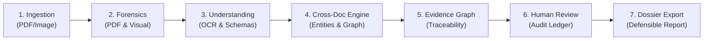

# EVIDEXA Product Overview

**AI-Powered Digital Forensics & Document Intelligence**  
*Intelligence Behind Every Evidence.*

---

## 1. Vision & Executive Summary

In financial lending, insurance underwriting, forensic accounting, and regulatory investigations, analysts are inundated with high volumes of complex, multi-page, mixed-format documents. Modern fraud involves subtle digital tampering: spliced bank statements, copy-pasted invoice figures, modified PDF incremental update streams, cloned signature blocks, and synthetic applicant networks.

Existing enterprise software forces investigators into a painful compromise:
- **Traditional OCR & IDP Tools** extract clean text but are completely blind to pixel-level tampering, font injections, or structural file manipulation.
- **Standalone Image Forensics Tools** generate raw heatmaps (such as Error Level Analysis or DCT grids) but fail to extract structured business data, link entities across files, or explain findings in business context.
- **Black-Box AI Scoring Models** emit opaque risk scores (e.g. "87% Risk") without explaining *why*, offering zero audit trails or legally defensible evidence provenance.

**EVIDEXA** solves this crisis by unifying **structural digital forensics**, **optical document understanding**, and **cross-document contextual intelligence** into a single, cohesive, evidence-traceable investigation platform.

---

## 2. The Five Pillars of EVIDEXA

EVIDEXA is architected around five interconnected capability pillars that transition raw files into defensible investigative dossiers:

```
┌────────────────────────────────────────────────────────────────────────┐
│                        EVIDEXA PRODUCT PILLARS                         │
└────────────────────────────────────────────────────────────────────────┘
     │                    │                    │                    │
┌────▼──────────────┐┌────▼──────────────┐┌────▼──────────────┐┌────▼──────────────┐
│  1. Ingestion &   ││   2. Digital      ││  3. Contextual &  ││   4. Evidence     │
│   Understanding   ││    Forensics      ││   Cross-Document  ││   Intelligence    │
├───────────────────┤├───────────────────┤├───────────────────┤├───────────────────┤
│ • Hybrid OCR      ││ • PDF Structure   ││ • Entity Resolution││ • Unified Graph   │
│ • Canonical Coords││ • Incremental Upd ││ • Ontology V2 SPO ││ • Bounding Boxes  │
│ • Schema Extract  ││ • ELA & DCT Tamper││ • Cross-Doc Match ││ • Token IDs       │
│ • Decimal Precision││• Font Inconsistency││• Contradiction Pre││• Chain-of-Custody│
└───────────────────┘└───────────────────┘└───────────────────┘└───────────────────┘
                                   │
                         ┌─────────▼─────────┐
                         │ 5. Investigation  │
                         │    & Reporting    │
                         ├───────────────────┤
                         │ • Case Workspace  │
                         │ • Human-in-the-Loop│
                         │ • Audit Ledger    │
                         │ • Defensible Report│
                         └───────────────────┘
```

### Pillar 1: Document Ingestion & Understanding
- **Multi-Format Ingestion:** Ingests digital PDFs, scanned PDFs, multi-page TIFFs, and raster images (PNG, JPEG).
- **Hybrid OCR Engine Routing:** Intelligently routes high-density vector pages to fast native extractors (PDFium) and scanned/raster pages to deep neural OCR (RapidOCR/ONNX) based on page-level heuristic density thresholds.
- **Canonical Coordinate System:** Normalizes all spatial references across engines to `NORMALIZED_0_1` (origin top-left $[0.0, 0.0]$, bounds $[1.0, 1.0]$), ensuring spatial consistency regardless of resolution or rotation.
- **Schema-Driven Structured Extraction:** Extracts structured fields (invoices, receipts, bank statements) with exact financial decimal precision (currency minor units) and immediate masking of sensitive identifiers (Aadhaar, PAN, Bank Accounts).

### Pillar 2: Digital Document Forensics
- **Structural PDF Analysis:** Inspects PDF internal object tables, cross-reference tables (XREF), linearization dictionaries, and incremental update streams to detect hidden revisions, disguised metadata, and injected objects.
- **Font & Stream Forensics:** Identifies anomalous embedded fonts, character code substitutions, and unexpected content stream modifications.
- **Visual Tampering Analysis:** Executes Error Level Analysis (ELA) and Discrete Cosine Transform (DCT) copy-move detection to reveal digital splicing, cloned text blocks, and altered financial numerals.
- **Coordinate-Honest Forensic Findings:** Structural findings without spatial footprints report `bounding_box=None`; visual anomalies pin exact pixel bounding boxes linked to the source page.

### Pillar 3: Contextual & Cross-Document Intelligence
- **Deterministic Entity Resolution:** Discovers and links entities (`ORGANIZATION`, `PERSON`, `TAX_IDENTIFIER`, `BANK_ACCOUNT`, `INVOICE_REFERENCE`) across diverse files within a case. Distinguishes exact matches, normalized matches, and candidate matches with explicit contradiction detection.
- **Directed Relationship Ontology (V2.0):** Employs formal Subject-Predicate-Object semantics (`Supplier --ISSUED--> Invoice`, `Invoice --BILLED_TO--> Buyer`, `Merchant --ISSUED--> Receipt`, `Bank --ISSUED--> Statement`, `Account --HELD_BY--> Holder`, `Person --REPRESENTS--> Org`, `Document --DUPLICATE_OF--> Document`).
- **Commercial Invariant Protection:** Strictly separates single invoice billing events (`INVOICED`) from long-term ongoing contractual supply relationships (`SUPPLIES`), reserving `SUPPLIES` exclusively for explicit contract clause evidence.
- **Epistemic Status Separation:** Decouples formal evidentiary status (`CONFIRMED`, `CANDIDATE`, `CONTRADICTED`, `UNRESOLVED`, `REJECTED`) from heuristic ranking scores, ensuring high scores cannot bypass required corroboration.

### Pillar 4: Evidence Intelligence & Provenance Graph
- **Unified Evidence Graph:** Connects cases, documents, pages, OCR tokens, forensic observations, extracted fields, resolved entities, and detected relationships into an interconnected directed acyclic graph.
- **Sub-Document Traceability:** Every conclusion and extracted value can be queried down to its exact source document, page number, normalized bounding box, and raw text token ID.
- **Contradiction Persistence:** When human investigators manually review or confirm relationships, pre-existing contradictory evidence signals are never deleted; they remain permanently attached to the record for supervisory review.
- **Chain of Custody & Audit Ledger:** Every state change, forensic run, and review decision is cryptographically chained via SHA-256 hash pointers into an append-only audit ledger.

### Pillar 5: Investigation Workspace & Reporting
- **Case-Centric Isolation:** All files, evidence nodes, and entities are strictly bounded by investigation cases. Cross-case data leakage is prevented at both the domain and API security levels.
- **Human-in-the-Loop Review:** Investigators review candidate matches and relationships with full context, accepting, rejecting, or marking unresolved with required written justifications.
- **Verifiable Investigation Dossiers:** Assembles comprehensive, exportable dossiers detailing verified findings, supporting evidence, visual heatmaps, contradictory signals, and explicit technical limitations.

---

## 3. End-to-End Investigation Lifecycle



1. **Ingest Case Documents:** The investigator creates a case and uploads evidentiary documents. The system computes SHA-256 digests immediately and generates immutable master snapshots.
2. **Execute Multi-Engine Forensics:** The forensic worker performs structural PDF analysis and visual anomaly detection in process-isolated environments with strict resource bounds.
3. **Extract Structured Information:** The document understanding layer classifies pages, performs hybrid OCR routing, extracts structured schemas with decimal financial precision, and masks sensitive PII.
4. **Resolve Entities & Detect Relationships:** The cross-document engine deterministically matches entities across files and detects directed relationships according to Ontology V2.
5. **Inspect the Evidence Graph:** The investigator explores connected evidence, viewing visual bounding boxes, OCR tokens, and supporting vs. contradicting signals.
6. **Record Human Review Decisions:** The investigator confirms or rejects candidates with recorded justifications, automatically updating the cryptographic audit ledger.
7. **Export Investigation Dossier:** The platform compiles a comprehensive, structured investigation dossier documenting verified facts, visual forensic exhibits, and complete chain-of-custody provenance.

---

## 4. Key Target Personas & Use Cases

| Persona | Primary Workflow | Key EVIDEXA Value |
|---|---|---|
| **Forensic Fraud Examiner** | Investigating suspected financial alteration in corporate lending packages. | Unmasks spliced bank balances, reveals PDF incremental update tampering, and correlates invoice citations with ERP records. |
| **Commercial Underwriter** | Evaluating multi-entity loan applications and trade finance documents. | Automatically verifies buyer-supplier invoices, cross-references corporate officers, and flags contradictory tax IDs. |
| **Claims Fraud Specialist** | Reviewing insurance claims containing medical receipts, repair bills, and invoices. | Detects duplicated invoices across claims (`DUPLICATE_OF`), identifies font substitutions, and flags digital stamp copy-moves. |
| **Forensic Accountant / Auditor** | Reconstructing transaction histories across multi-year bank statements and ledgers. | Extracts exact decimal amounts without floating-point drift, ensures zero plaintext account leaks, and validates transaction consistency. |

---

## 5. Summary

EVIDEXA is built on the belief that **AI in digital forensics must be an investigative telescope, not an unaccountable judge**. By grounding every insight in mathematical file analysis, explicit bounding boxes, and auditable human oversight, EVIDEXA sets a new standard for trustworthy, defensible document intelligence.

